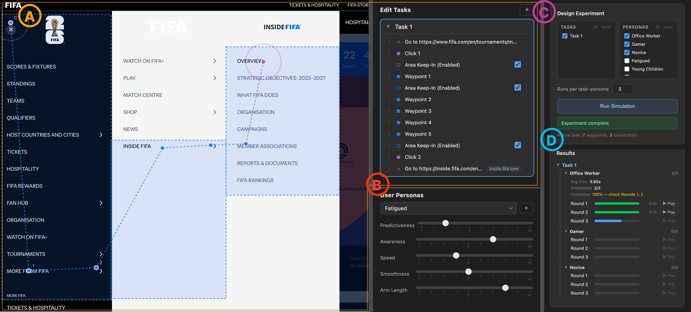

# Constraint-Aware Toolkit for Web GUI Design

A Chrome extension and Python backend for simulating how different kinds of users move a cursor through a **live website**. Draw waypoints and spatial constraints right on the page, choose user personas, and the toolkit generates human-like cursor trajectories. You can replay them as a ghost cursor that triggers real hover and click events, then compare completion time and constraint violations across personas.

Use it to check whether interactions like cascading menus, hover-dependent navigation, or small click targets work for users with different motor abilities, without recruiting participants for every design change.



*(A) Waypoints and keep-in/keep-out constraints drawn on a live page. (B) Persona editor. (C) Experiment setup (tasks × personas × runs). (D) Per-round results with replay.*

---

## Features

- **Design on the live page.** Place waypoints, click targets, rectangular areas and path corridors as keep-in or keep-out constraints directly over any website.
- **Multi-step tasks.** A task is an ordered list of steps (navigate to a URL, move, click, …), so flows can span several pages.
- **User personas.** Six built-in motor profiles (Office Worker, Gamer, Novice, Fatigued, Motor Impaired, Young Children), plus custom personas tuned with intuitive sliders (Predictiveness, Awareness, Speed, Smoothness, Arm Length).
- **Batch experiments.** Run every selected task × persona combination for N seeded rounds. Results report average time, completion rate and constraint violations.
- **Replay and visualize.** Play any round back as a ghost cursor that fires real DOM hover and click events, or overlay many trajectories at once, color-coded by persona.
- **Export.** Save trajectories as CSV, the full results as JSON, or a screenshot of the page with the overlay.

## How it works

```text
┌────────────── Chrome Extension ──────────────┐        ┌──────── Backend (localhost:8000) ────────┐
│ content/   overlay, design modes, replay     │  HTTP  │ server.py  (FastAPI)                     │
│ sidepanel/ tasks, personas, experiments,     │ ─────▶ │   └─ hcs_package.CursorSimulator         │
│            playback, visualization, export   │ ◀───── │       reference path → GAM speed model → │
│ background.js                                │  JSON  │       MPCC optimizer → motor/mouse noise │
└──────────────────────────────────────────────┘        └──────────────────────────────────────────┘
```

The simulator ([`hcs_package`](hcs_package/README.md)) uses **Model Predictive Contouring Control (MPCC)** to follow a constraint-aware reference path. A geometry-adaptive **GAM speed model** sets the target speed and **signal-dependent motor noise** adds variability. Each persona is a set of planner weights, a planning horizon, noise coefficients and a forearm length.

## Getting started

### Prerequisites

- Python 3.8+ (developed on 3.10)
- Google Chrome (Manifest V3, Side Panel API: Chrome 114+)

### 1. Install the backend

```bash
python -m venv hcs-env
source hcs-env/bin/activate
pip install -r requirements.txt
pip install -e hcs_package
pip install pygam            # required for the GAM speed model
```

### 2. Start the server

```bash
source hcs-env/bin/activate
python server.py             # serves http://localhost:8000
curl http://localhost:8000/health
```

### 3. Load the extension

1. Open `chrome://extensions/` and turn on **Developer mode**.
2. Click **Load unpacked** and select this repository's root folder.
3. Click the extension icon to open the side panel.
4. **Refresh any tab that was already open.** Content scripts only run in pages loaded after the extension.

## Usage

1. **Create a task** in *Edit Tasks*. Hold a design key, act on the page, and release the key to exit the mode.
2. **Pick or tune personas** in *User Personas*.
3. **Design the experiment.** Select tasks and personas, set *Runs per task–persona*, then click **Run Simulation**.
4. **Inspect results.** Expand a task and persona to see each round, then press **▶ Play** to replay it on the page, or use **Show on Page** to overlay several trajectories.
5. **Export** as CSV, JSON or a screenshot.

### Design shortcuts

| Key | Mode | Action |
|-----|------|--------|
| **Q** | Add waypoint | Click to place waypoints |
| **W** | Move waypoint | Drag an existing waypoint |
| **E** | Add click | Click to place a click waypoint |
| **S** | Area keep-in | Drag to draw a rectangle the cursor should stay inside |
| **D** | Corridor keep-in | Click path points; release to finalize the corridor |
| **F** | Area keep-out | Drag to draw a rectangle the cursor should avoid |
| **G** | Corridor keep-out | Click path points; release to finalize the corridor |
| **A** | Adjust | Drag a constraint's edge or points to resize or move it |
| **Esc** | Passthrough | Leave design mode and interact with the page normally |
| **⌘Z / ⌘⇧Z** | Undo / Redo | Undo or redo the last waypoint or constraint |

## API

`POST /api/simulate` takes a task (pixel waypoints, screen size, normalized constraints), an optional persona config and seed, and the viewport. It returns the trajectory as `[[x, y, t], …]` with cumulative timestamps in seconds.

```json
{
  "task": {
    "waypoints": [[100, 200], [300, 250], [500, 300]],
    "screen_width": 1920,
    "screen_height": 1080,
    "constraints": { "coordinate_system": "normalized", "regions": [ ... ] }
  },
  "user_config": { "Th": 0.3, "nc": [0.2, 0.02], "planner_weights": { ... } },
  "random_seed": 42,
  "viewport": { "width": 1920, "height": 1080 }
}
```

The constraint schema and persona parameters are documented in [hcs_package/README.md](hcs_package/README.md). Other endpoints are `GET /` (API info) and `GET /health`.

## Repository layout

```text
├── manifest.json        # Chrome extension manifest (MV3)
├── background.js        # Service worker
├── content/             # Page overlay: state, drawing, design modes, replay, key events
├── content.css
├── sidepanel.html       # Side panel UI
├── sidepanel/           # Tasks, personas, experiment runner, playback, visualization/export
├── server.py            # FastAPI backend
├── requirements.txt
├── hcs_package/         # Human-like cursor simulator (MPCC + GAM speed model)
└── plan/                # User study notes
```

## Troubleshooting

| Symptom | Fix |
|---------|-----|
| Nothing draws on the page | Refresh the tab after installing or reloading the extension, and click on the page itself rather than the side panel. |
| "Run Simulation" fails | Make sure the server is running (`curl localhost:8000/health`) and the step has at least 2 waypoints. |
| Import errors on the server | Activate `hcs-env` and run `pip install -e hcs_package` and `pip install pygam`. |
| Extension errors | See `chrome://extensions/` → **Errors**, and the page console (F12). |

See also [QUICK_START.md](QUICK_START.md) and [SETUP.md](SETUP.md).

## License

[MIT](LICENSE)
